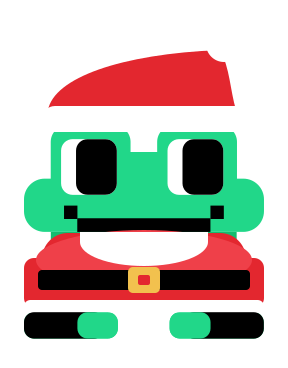
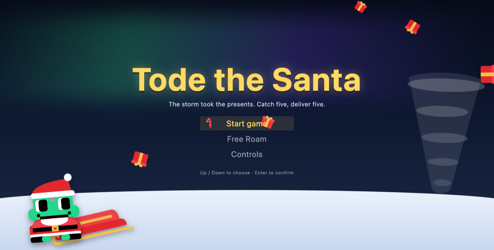
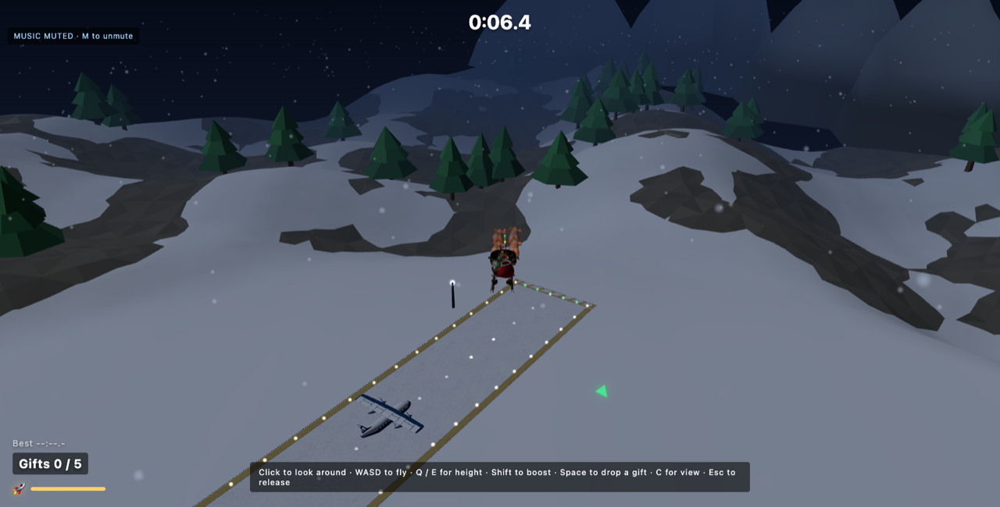
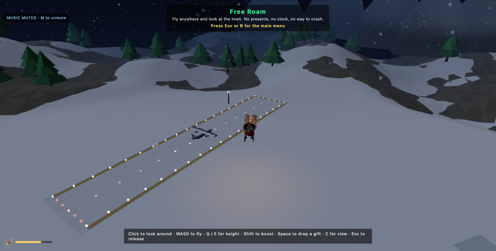

<p align="center">
  
</p>

<h1 align="center">Tode the Santa</h1>

<p align="center"><em>The storm took the presents. Catch five, deliver five.</em></p>

<p align="center">
  Built for the JetBrains <strong>Build a Game with an AI Coding Agent</strong> hackathon ·
  <a href="https://threejs.org/">three.js</a> · <a href="https://vite.dev/">Vite</a>
</p>

---

## About

Tode the frog is Santa this Christmas. A storm tore the gifts out of his sleigh
and they are still up there, turning in the wind — so he flies after them.

A run is two halves:

1. **Catch five gifts.** They drift over a snowed-in valley. Fly through one and
   it goes in the sack.
2. **Deliver five gifts.** Five houses stand in the field below. Pass over each
   one and drop a present on its doorstep.

Do both and the town lights come on. There is no combat and no score — just a
clock, so the only thing to beat is your own best run. A **Free Roam** mode is
there if you'd rather just fly around and look at the place.

Everything runs in the browser on plain three.js: no engine, no physics library,
no framework. Each system lives in its own module under `src/components/` —
flight, camera, gifts, delivery, boost, timer, aurora, Christmas lights, menus.

## Setup and run

Needs [Node.js](https://nodejs.org) 20.19+ (built on 26).

```bash
cd game
npm install
npm run dev       # dev server with hot reload, prints a localhost URL
```

Then open the printed URL — the title screen comes up with **Start game**,
**Free Roam** and **Controls**.

```bash
npm run build     # production bundle into dist/
npm run preview   # serve that bundle locally
```

## Controls

| Key | What it does |
| --- | --- |
| `W` / `S` | Fly forward / back |
| `A` / `D` | Bank left / right |
| `E` / `Q` | Climb / descend |
| `Left Shift` | Boost — burns a meter, refills over time and on every catch |
| `Space` | Drop a gift on the house below |
| `C` | Switch camera |
| `Right mouse` | Hold and move the mouse to look around |
| `M` | Mute / unmute the music |
| `G` | God mode |

The same table is in the game under **Controls** on the title screen.

## Screenshots

<p align="center">
  
</p>

<p align="center">
  
  <br><em>A run: the clock up top, <code>Gifts 0 / 5</code> and the boost meter bottom-left, the green arrow pointing at the next gift.</em>
</p>

<p align="center">
  
  <br><em>Free Roam: no presents, no clock, no way to crash.</em>
</p>

## Hackathon

This game was built for JetBrains' **Build a Game with an AI Coding Agent**
course/hackathon ([Coursera](https://www.coursera.org/learn/jb-build-game-with-ai-agent/)),
which is what the rest of this repository is — the course materials live in the
folders above this one, and the game itself is everything in `game/`.

The feature specs the agent worked from are kept in `game/hackathon/`, one
folder per task (`core_loop/gift_catch`, `core_loop/gift_delivery`,
`conclusion/win_state`, `menu/controls`, `menu/free_roam`), alongside
`game_story.md`, which holds the story and the asset inventory.

## Credits

- Sound effects — [Kenney](https://kenney.nl) "Digital Audio" pack, CC0. Details
  in `public/sfx/LICENSE.txt`.
- Music — `public/music/`, claim-free track, free to use.
- 3D models — `public/models/`, loaded as glTF.
- Course and project scaffolding — JetBrains Academy, MIT licensed (see
  `../LICENSE`).
